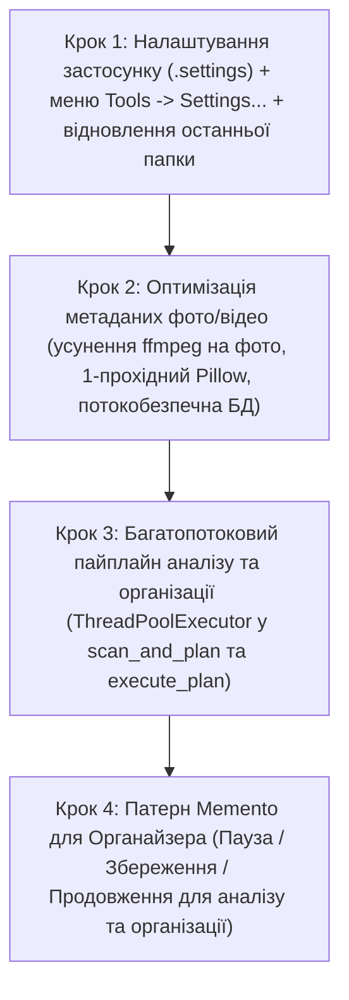

# План розробки фічі: Організатор медіафайлів за роками і місяцями

---

## 1. Аудит стану розробки: Що зроблено, що переробити, що додати

### 1.1. Що вже зроблено добре — `[ВИКОНАНО ДОБРЕ]`
1. **Розумний парсер дат із пріоритетом назви файлу ([date_extractor.py](file:///C:/Users/Oleksander/Alex/Projects/family_album/src/family_album/utility_functions/date_extractor.py))**:
   - Розпізнає патерни смартфонів, камер, скріншотів, месенджерів (`IMG_...`, `VID_...`, `PXL_...`, `Screenshot_...`, `WhatsApp...`, ISO-дати, Unix timestamps).
   - Валідує календарні межі ($1970 \le \text{year} \le \text{current\_year} + 1$).
   - Дотримується пріоритету: `Назва файлу` $\rightarrow$ `EXIF / Метадані відео` $\rightarrow$ папка `No_Date/`.
2. **Локальний SQLite-каталог у цільовій папці ([organizer_db.py](file:///C:/Users/Oleksander/Alex/Projects/family_album/src/family_album_lib/organizer_db.py))**:
   - Зберігає базу даних у `<target_dir>/.db/album.db` (таблиці `organized_files`, `organizer_sessions`, `organizer_log`).
   - Підтримує перевірку актуальності каталогу (`verify_catalog_actuality`) та пошук за хешем (`find_by_hash`).
3. **Два режими організації та інваріант безпеки ([file_organizer_engine.py](file:///C:/Users/Oleksander/Alex/Projects/family_album/src/family_album_lib/file_organizer_engine.py))**:
   - **Нова організація**: створює поруч `<source>_organized`, перевіряє вільне місце на диску перед `Copy` та пропонує перехід на `Move` при нестачі місця.
   - **Самоорганізація**: автоматично активується при наявності `<source>/.db/album.db` (`Move` всередині папки з пропуском вже організованих `YYYY/MM` та `No_Date`).
   - **Абсолютна безпека даних**: жоден файл ніколи не видаляється і не перезаписується; колізії імен вирішуються суфіксами `_copy1`, `_copy2` тощо.
4. **Базовий графічний інтерфейс ([file_organizer.py](file:///C:/Users/Oleksander/Alex/Projects/family_album/src/family_album/gui/widgets/file_organizer.py))**:
   - Вибір Source/Target директорій, перемикачі режимів та операцій, таблиця попереднього перегляду плану (`tbl_file_data`), індикатор стану БД та прогрес-бар.

---

### 1.2. Що треба переробити / оптимізувати — `[ПОТРЕБУЄ ПЕРЕРОБКИ]`
1. **Критичне гальмування в `is_file_a_video()` ([video_utils.py](file:///C:/Users/Oleksander/Alex/Projects/family_album/src/family_album/utility_functions/video_utils.py#L20-L59))**:
   - Зараз для кожного файлу без відео-розширення (тобто для **кожної фотографії** `.jpg`/`.png`) у гілці `else:` викликається `VideoFileClip(file_name)`, який запускає зовнішній процес ОС `ffmpeg.exe` (~100 мс на кожен файл!).
   - Об'єкти `cv2.VideoCapture` та `VideoFileClip` не закриваються (`cap.release()`, `clip.close()`).
   - **Рішення**: визначати приналежність до відео виключно за відомими розширеннями + `cv2.VideoCapture`, додати швидку функцію `get_video_resolution_fast()` через OpenCV і гарантовано звільняти ресурси у `finally`.
2. **Багаторазове відкриття одного файлу при читанні метаданих ([image_utils.py](file:///C:/Users/Oleksander/Alex/Projects/family_album/src/family_album/utility_functions/image_utils.py), [date_extractor.py](file:///C:/Users/Oleksander/Alex/Projects/family_album/src/family_album/utility_functions/date_extractor.py))**:
   - Зараз під час сканування одне фото відкривається з диска 5–7 разів поспіль (`is_file_a_video`, `is_image_file`, `_get_image_info_pil`, `_get_image_info` без `details=False`, `get_image_size`, `get_image_maker`).
   - **Рішення**: зробити однопрохідну інспекцію заголовка зображення через Pillow (`inspect_image_fast`), читати EXIF Sub-IFD (`0x8769`) напряму через Pillow, а `exifread` викликати лише як резервний варіант із `details=False`.
3. **Однопотоковий аналіз та організація у `FileOrganizerEngine` ([file_organizer_engine.py](file:///C:/Users/Oleksander/Alex/Projects/family_album/src/family_album_lib/file_organizer_engine.py))**:
   - Зараз `scan_and_plan()` та `execute_plan()` обробляють файли послідовно в одному потоці, а при натисканні `Organize Files` сканування запускається вдруге з нуля.
   - **Рішення**: розпаралелити пофайловий аналіз (`scan_and_plan`) та пофайлове копіювання/переміщення (`execute_plan`) через `ThreadPoolExecutor(max_workers=...)`, а також перевикористовувати вже побудований план.
4. **Жорстко фіксована кількість потоків (200) у пошуку дублікатів ([resumable_duplicate_analyser.py](file:///C:/Users/Oleksander/Alex/Projects/family_album/src/family_album_lib/resumable_duplicate_analyser.py#L19))**:
   - Константа `_NUM_OPEN_FILES = 200` перевантажує домашній ноутбук.
   - **Рішення**: передавати кількість потоків із глобальних налаштувань застосунку (`AppSettings.worker_threads`).

---

### 1.3. Що треба розробити — `[НОВИЙ ФУНКЦІОНАЛ]`
1. **Система налаштувань застосунку (`.settings/settings.json`) та діалог `Tools -> Settings...`**:
   - Збереження налаштувань у папці `.settings` поруч із виконуваним файлом / коренем проекту.
   - Автоматичне визначення кількості логічних ядер процесора при першому старті (`cpu_cores * 2`) та створення файлу налаштувань.
   - Збереження та автоматичне відновлення останньої вибраної директорії при запуску програми.
   - Діалогове вікно `Tools -> Settings...` для перегляду та зміни кількості потоків і стартової директорії.
2. **Патерн Memento для Органайзера (Пауза, Збереження стану, Продовження з місця зупинки)**:
   - Підтримка зупинки (`Stop`), збереження стану (`Save State`) та відновлення (`Resume`) як для процесу **аналізу** (`scan_and_plan`), так і для процесу **організації** (`execute_plan`) поточної папки.

---

## 2. Покроковий план виконання (Крок за кроком з перевіркою та комітами)

---

### Крок 1: Клас налаштувань застосунку (`.settings`) та діалог `Tools -> Settings...` — `[ВИКОНАНО]`
**Мета**: Створити централізоване сховище налаштувань у `<app_dir>/.settings/settings.json`, автоматично визначати оптимальну кількість потоків при першому запуску, відновлювати останню вибрану директорію та додати вікно налаштувань у меню.
- [x] **1.1. Модуль `src/family_album_lib/app_settings.py` (`AppSettings`)**:
  - Визначення папки застосунку (поруч із `.exe` при PyInstaller-збірці або корінь проекту при запуску з коду).
  - При першому запуску (якщо `.settings/settings.json` ще немає): визначення доступних логічних ядер процесора (`os.cpu_count()`) та розрахунок кількості потоків за замовчуванням: `worker_threads = cpu_cores * 2` (у діапазоні `1..256`), автоматичне створення `.settings/settings.json`.
  - Збереження параметрів: `worker_threads`, `last_selected_directory`.
- [x] **1.2. Діалог `src/family_album/gui/dialogs/settings_dialog.py` (`SettingsDialog`)**:
  - Відображення кількості виявлених ядер CPU та рекомендованої кількості потоків (`cores × 2`).
  - Повзунок (`QSlider`) + числове поле (`QSpinBox`) для зміни кількості потоків + кнопка скидання до рекомендованого значення.
  - Поле перегляду/зміни останньої вибраної директорії та шляху до файлу `.settings/settings.json`.
- [x] **1.3. Інтеграція у `MainWindow`, `DirectoryView`, `DuplicationChecker` та `FileOrganizer`**:
  - Додати меню `Tools -> Settings...` (`Ctrl+,`) у [main_window.py](file:///C:/Users/Oleksander/Alex/Projects/family_album/src/family_album/gui/main_window.py).
  - У [directory_view.py](file:///C:/Users/Oleksander/Alex/Projects/family_album/src/family_album/gui/widgets/directory_view.py) додати метод `select_directory(path)` для програмного розгортання та вибору збереженої папки у дереві при старті.
  - При виборі папки в `MainWindow.evt_dir_selected()` автоматично зберігати її в `AppSettings.last_selected_directory`.
  - Передавати `AppSettings.worker_threads` в обидва інструменти: `ResumableDuplicateAnalyser` / `DuplicationChecker` (замість жорстких `200`) та `FileOrganizer` / `OrganizerWorker`.
- [x] **1.4. Тестування Кроку 1**:
  - Написано модульні тести [tests/test_app_settings.py](file:///C:/Users/Oleksander/Alex/Projects/family_album/tests/test_app_settings.py) (5 тестів, 100% pass).

---

### Крок 2: Оптимізація швидкодії визначення метаданих фото та відео — `[ВИКОНАНО]`
**Мета**: Усунути запуск `ffmpeg` на фотографіях та багаторазове читання файлів з диска.
- [x] **2.1. Оптимізація [video_utils.py](file:///C:/Users/Oleksander/Alex/Projects/family_album/src/family_album/utility_functions/video_utils.py)**:
  - У `is_file_a_video()` перевіряється список відео-розширень (`VIDEO_EXTENSIONS`) і миттєво повертається `False` для не-відео файлів (без виклику `VideoFileClip` / `ffmpeg`), а для анімованих `.gif` використовується швидка перевірка через Pillow (`_is_animated_gif`).
  - Додано `has_video_extension()` та `get_video_resolution_fast()` через `cv2.VideoCapture` (та Pillow для `.gif`) замість важкого `MoviePy`.
  - Гарантовано закриття `cap.release()` та `clip.close()` у блоках `finally`.
- [x] **2.2. Оптимізація [image_utils.py](file:///C:/Users/Oleksander/Alex/Projects/family_album/src/family_album/utility_functions/image_utils.py) та [date_extractor.py](file:///C:/Users/Oleksander/Alex/Projects/family_album/src/family_album/utility_functions/date_extractor.py)**:
  - Додано `IMAGE_EXTENSIONS`, `has_image_extension()` та `inspect_image_fast(file_path)` для отримання `(is_image, resolution, maker)` за одне відкриття заголовка Pillow; виправлено закриття дескриптора у `_is_image_pillow()` та обмежено `cv2.imread()` fallback лише відомими розширеннями зображень.
  - У `extract_date_from_exif()` реалізовано швидкий шлях `extract_date_from_pil_exif()` через Pillow `getexif()` + Exif Sub-IFD (`0x8769`), використовуючи `exifread.process_file(..., details=False)` лише як резервний варіант.
- [x] **2.3. Потокобезпечність [organizer_db.py](file:///C:/Users/Oleksander/Alex/Projects/family_album/src/family_album_lib/organizer_db.py)**:
  - Додано `check_same_thread=False` та `threading.RLock()` для безпечного багатопотокового доступу з пулу потоків.
- [x] **2.4. Тестування Кроку 2**:
  - Розширено та пройдено тести `test_video_utils.py`, `test_image_utils.py`, `test_date_extractor.py`, `test_organizer_db.py` (перевірено відсутність викликів MoviePy на фото, пропуск `exifread` при наявності Pillow EXIF, та паралельний запис у БД із 8 потоків).

---

### Крок 3: Паралелізація пайплайну аналізу та організації (`ThreadPoolExecutor`) — `[ВИКОНАНО]`
**Мета**: Розпаралелити пофайловий аналіз та пофайлове копіювання/переміщення на кількість потоків із `AppSettings.worker_threads`.
- [x] **3.1. Паралельний однопрохідний аналіз у `FileOrganizerEngine.scan_and_plan()`**:
  - Запускається обробка файлів через `ThreadPoolExecutor(max_workers=max_workers)` (`AppSettings.worker_threads`).
  - Реалізовано однопрохідний `_inspect_single_file()`: 1 відкриття заголовка Pillow для фото (розмір, виробник, EXIF Sub-IFD), швидкий OpenCV `get_video_resolution_fast()` для відео без запуску MoviePy при наявності дати в імені файлу.
  - Коректна зупинка за `cancel_event` та тротлінг оновлень прогресу (50 мс) + оптимізація рендеру великих таблиць у `FileOrganizer._populate_plan_table()`.
- [x] **3.2. Паралельна організація у `FileOrganizerEngine.execute_plan()`**:
  - Копіювання/переміщення та розрахунок хешу `Blake2b` кожного файлу виконуються паралельно в потоках `ThreadPoolExecutor(max_workers=max_workers)`.
  - Атомарне резервування унікального імені (`_copyN`) через `_reserve_unique_destination()` + `collision_lock` (виправлено також колізії різних файлів у `safe_move_file`), перевикористання `src_hash` без повторного хешування та потокобезпечний запис у SQLite.
  - Перевикористання готового плану (`existing_plan`) при переході від `Analyze / Preview` до `Organize Files...` без повторного сканування.
  - Усунено дублювання логів і зайвий спам `MainWindow.evt_update_progress` під час роботи органайзера.
- [x] **3.3. Тестування Кроку 3**:
  - Додано 4 нові тести у [test_file_organizer_engine.py](file:///C:/Users/Oleksander/Alex/Projects/family_album/tests/test_file_organizer_engine.py) (60 файлів паралельно, стрес-тест 20 колізій імен при `move` у 8 потоків, перевикористання плану без повторного сканування, відсутність виклику MoviePy на відео з датою в імені) — **54/54 тести проходять**.

---

### Крок 4: Патерн Memento для Органайзера (Пауза / Збереження стану / Відновлення) — `[ВИКОНАНО]`
**Мета**: Дозволити зупиняти, зберігати та продовжувати з місця зупинки як процес аналізу, так і процес організації для поточної папки.
- [x] **4.1. Модуль [organizer_memento.py](file:///C:/Users/Oleksander/Alex/Projects/family_album/src/family_album_lib/organizer_memento.py)**:
  - Створено класи `OrganizerStatus`, `OrganizerMemento`, `OrganizerSaveManager` (збереження у `saves/organizer_save_<hash>.json`).
  - Підтримка фаз `phase="analyze"` (зберігає вже проаналізовані елементи плану) та `phase="organize"` (зберігає весь план зі статусами `organized`/`skipped`/`pending` та накопичену статистику `OrganizeStats`).
  - Метод `verify_location(memento)` перевіряє цілісність папки та наявність незавершених (`pending`) файлів перед відновленням.
- [x] **4.2. Інтеграція Memento в `FileOrganizerEngine` та GUI віджет `FileOrganizer`**:
  - Додано серіалізацію `to_dict()` / `from_dict()` у `MediaDateResult`, `OrganizePlanItem`, `OrganizeStats`.
  - У `scan_and_plan()` реалізовано пропуск уже проаналізованих файлів із `existing_items` (без повторного читання з диска).
  - У `execute_plan()` реалізовано продовження з `initial_stats` і пропуск елементів зі статусом `organized`/`skipped`.
  - В `OrganizerWorker` додано сигнал `paused(phase, plan, stats, total_files)`.
  - У [file_organizer.py](file:///C:/Users/Oleksander/Alex/Projects/family_album/src/family_album/gui/widgets/file_organizer.py) додано кнопки **Save State** та **Resume**, перейменовано `Stop` на **Stop / Pause**, реалізовано діалог пропозиції відновлення при виявленні збереженого чекпоїнту та автовидалення сейву після успішного завершення.
- [x] **4.3. Тестування Кроку 4**:
  - Написано та пройдено тести [tests/test_organizer_memento.py](file:///C:/Users/Oleksander/Alex/Projects/family_album/tests/test_organizer_memento.py) (5 нових тестів; загалом **59/59 тестів проходять**).

---

### Крок 5: Мінімальна валідна дата (`2000-01-01`) у налаштуваннях + Fallback на `Last Modified` файлу — `[ВИКОНАНО]`
**Проблема (виявлена на реальному домашньому архіві)**:
1. Занадто багато файлів без EXIF і без дати в імені потрапляли до `No_Date/`, хоча у властивостях файлу (`Last Modified`) була валідна дата.
2. Згенеровані анімації та колажі з Google Photos містили фіктивні епохові дати `1970-01-01` та `1980-01-01`, які при виборі найранішої дати перебивали реальну дату файлу.

**Завдання**:
- [x] **5.1. Мінімальна валідна дата в `AppSettings` та `SettingsDialog`**:
  - Додано поле `min_valid_date` (ISO `"YYYY-MM-DD"`, за замовчуванням `"2000-01-01"`) та властивість `min_valid_datetime` у [app_settings.py](file:///C:/Users/Oleksander/Alex/Projects/family_album/src/family_album_lib/app_settings.py).
  - Додано `QDateEdit` (із календарем та кнопкою `Reset (2000-01-01)`) у [settings_dialog.py](file:///C:/Users/Oleksander/Alex/Projects/family_album/src/family_album/gui/dialogs/settings_dialog.py) (`Tools -> Settings...`) та інвалідацію кешованого плану в `MainWindow` при зміні порогу.
- [x] **5.2. Фільтрація дат за `min_valid_date` та Fallback на системні дати файлу (`os.stat`)**:
  - Оновлено `is_valid_date()` у [date_extractor.py](file:///C:/Users/Oleksander/Alex/Projects/family_album/src/family_album/utility_functions/date_extractor.py) для фільтрації будь-яких дат `< min_valid_date` (відкидає `1970` і `1980` роки).
  - Додано функцію `extract_date_from_filesystem(file_path, min_date)` (бере найранішу валідну дату серед `st_mtime`, `st_ctime`, `st_birthtime`, але відхиляє файли, чий власний `st_mtime < min_date`, щоб не підставляти сьогоднішній `st_ctime` для 1980-епохових ZIP-архівів).
  - Підключено filesystem fallback як Пріоритет №3 у `FileOrganizerEngine._inspect_single_file()` (`Filename` $\rightarrow$ `EXIF / Video` $\rightarrow$ `File System (Last Modified)` $\rightarrow$ `No_Date/`).
- [x] **5.3. Тестування Кроку 5**:
  - Додано тести у [test_app_settings.py](file:///C:/Users/Oleksander/Alex/Projects/family_album/tests/test_app_settings.py), [test_date_extractor.py](file:///C:/Users/Oleksander/Alex/Projects/family_album/tests/test_date_extractor.py) та [test_file_organizer_engine.py](file:///C:/Users/Oleksander/Alex/Projects/family_album/tests/test_file_organizer_engine.py) зі згенерованим JPEG (фіктивні EXIF `1970`/`1980` + валідний `Last Modified` `2019-08-22`), згенерованим AVI-відео без метаданих + валідний `Last Modified` (`2021-11-05`) та перевіркою `No_Date/` для 1980-епохи — **63/63 тести проходять**.

---

### Крок 6: Багатопотокова верифікація дублікатів із паузою/збереженням (`ResumableDuplicatesVerifier`) — `[ВИКОНАНО]`
**Мета**: Додати окремий 2-й етап перевірки **виключно для знайдених дублікатів** (порівняння точного розміру файлу оригіналу та його дублікатів у багатопотоковому режимі), який можна зупинити, зберегти у Memento та продовжити навіть після перезапуску застосунку на наступний день.
- [x] **6.1. Новий клас `ResumableDuplicatesVerifier` ([resumable_duplicates_verifier.py](file:///C:/Users/Oleksander/Alex/Projects/family_album/src/family_album_lib/resumable_duplicates_verifier.py))**:
  - Побудовано за аналогією з `ResumableDuplicateAnalyser` (`ThreadPoolExecutor(max_workers=AppSettings.worker_threads)`, `Event` для кооперативної паузи, статус `DuplicationCheckStatus`, колбеки `start_verification`, `update_progress`, `log_event`, `finish_verification`).
  - Працює тільки над групами дублікатів (`{original: [dup1, dup2, ...]}`), порівнюючи точний розмір файлу в байтах (`os.path.getsize`) оригіналу та кожного кандидата-дубліката.
  - Пропускає вже перевірені групи при відновленні (`verified_originals`), відсіює файли з розбіжністю розміру у `mismatched_files` (із попередженням `WARNING` у лог) та формує очищений словник підтверджених дублікатів `verified_duplicates`.
  - Підтримує `create_memento()` та `restore_memento()` для повної інтеграції з `DuplicationSaveManager`.
- [x] **6.2. Розширення `DuplicationCheckMemento` ([duplication_memento.py](file:///C:/Users/Oleksander/Alex/Projects/family_album/src/family_album_lib/duplication_memento.py))**:
  - Додано `DuplicationStage` (`HASHING = "hashing"`, `VERIFYING = "verifying"`) та поле `stage` (`"hashing"` за замовчуванням для зворотної сумісності зі старими сейвами).
  - **Збережено повний результат 1-го етапу** (`files_hashes`, `processed_files`, `files_count`, `subdirectories_count`) разом із прогресом 2-го етапу, щоб після перезапуску програми не доводилося перераховувати хеші та залишалися доступними `Dump`, `Move`, аналіз дублікатів папок і повний перелік кандидатів для продовження верифікації.
  - Додано поля стану верифікації: `verified_duplicates` (`Dict[str, List[str]]`), `verified_originals` (`List[str]`), `mismatched_files` (`List[dict]`) та властивість `candidate_duplicate_groups_count`.
  - Забезпечено коректну верифікацію локації (`verify_location`) для обох етапів.
- [x] **6.3. Оновлення GUI у [duplication_checker.py](file:///C:/Users/Oleksander/Alex/Projects/family_album/src/family_album/gui/widgets/duplication_checker.py)**:
  - Додано на панель **лише одну нову кнопку**: **`Verify Duplicates`** (`pbVerifyDuplicates`), активну після завершення пошуку дублікатів.
  - Існуючі кнопки **`Stop / Pause`**, **`Save State`**, **`Resume Check`** автоматично працюють із поточним активним етапом (`_active_stage`: `"hashing"` або `"verifying"`), визначаючи його за станом віджета або полем `memento.stage` після перезапуску програми.
  - Після завершення верифікації оновлюються списки дублікатів підтвердженими даними, зберігається `files_hash` з 1-го етапу та виводиться детальний підсумок верифікації (`_log_verification_summary()`).
- [x] **6.4. Тестування Кроку 6**:
  - Написано модульні та GUI-тести [test_duplicates_verifier.py](file:///C:/Users/Oleksander/Alex/Projects/family_album/tests/test_duplicates_verifier.py) (багатопотокова верифікація розмірів, виявлення імітованої хеш-колізії з іншим розміром файлу, пауза/збереження/відновлення через `stage="verifying"` зі збереженням 1-го етапу, інтеграція `DuplicationChecker`) — **69/69 тестів проходять**.

---

### Крок 7: Фінальне полірування перед злиттям гілки — `[НАСТУПНИЙ КРОК]`
- [ ] **7.1. Самоорганізація**: замінити `has_database()` на `is_valid_database()` та запускати `verify_catalog_actuality()` у режимі Self-Organization із виведенням звіту в лог/статус.
- [ ] **7.2. Документація**: оновити [docs/organizer_diagram.md](file:///C:/Users/Oleksander/Alex/Projects/family_album/docs/organizer_diagram.md) та [README.md](file:///C:/Users/Oleksander/Alex/Projects/family_album/README.md).
- [ ] **7.3. Гігієна репозиторію**: видалити мертвий [dataframe_model.py](file:///C:/Users/Oleksander/Alex/Projects/family_album/src/family_album/gui/dataframe_model.py) та додати `saves/`, `tests/saves/`, `*.db` у [.gitignore](file:///C:/Users/Oleksander/Alex/Projects/family_album/.gitignore).

---

## 3. Відкладено на майбутні релізи (Backlog)
- **Undo / Rollback (Відкат останньої організації)** — `[ВІДКЛАДЕНО]` (база даних `.db/album.db` вже зберігає всі пари `original_path` $\rightarrow$ `organized_path` для майбутньої реалізації).
