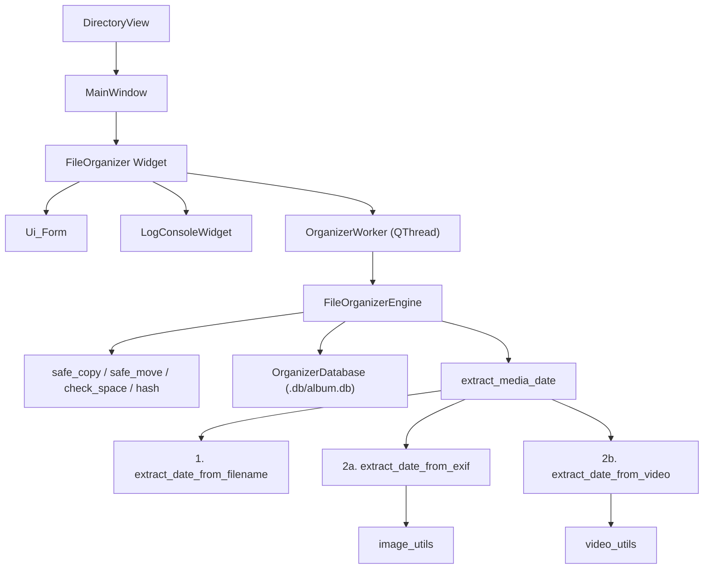

# File Organizer Architecture & Workflow

The **File Organizer** feature is built on a three-tier architecture:
1. **GUI Layer (PyQt6)** — User interaction, mode configuration, preview table, and progress tracking.
2. **Domain Engine & Worker Thread (`QThread`)** — Non-blocking directory scanning, plan generation, disk space verification, safe file transfer, and Blake2b hashing.
3. **Metadata Utilities & SQLite Catalog** — Priority-based capture date extraction and transactional audit logging in `<target>/.db/album.db`.

---

## 1. Dependency Diagram (From Widget to Core Functionality)

### Visual Architecture Diagram

```text
+-----------------------------------------------------------------------------------+
| 1. GUI LAYER (src/family_album/gui)                                               |
|                                                                                   |
|  +-----------------------+     ItemSelected(str)     +-------------------------+  |
|  |     DirectoryView     | ------------------------> |       MainWindow        |  |
|  |  (directory_view.py)  |                           |    (main_window.py)     |  |
|  +-----------------------+                           +-------------------------+  |
|                                                                   |               |
|                                                      sets selected_path           |
|                                                                   v               |
|  +-----------------------+       inherits            +-------------------------+  |
|  |        Ui_Form        | <------------------------ |      FileOrganizer      |  |
|  | (file_organizer_ui.py)|                           |   (file_organizer.py)   |  |
|  +-----------------------+                           +-------------------------+  |
|                                                        |          |          |    |
|  +-----------------------+     LogEventEmitted(str)    |          |          |    |
|  |   LogConsoleWidget    | <---------------------------+          |          |    |
|  |   (log_console.py)    |                                        |          |    |
+-------------------------------------------------------------------|----------|----+
                                                                    |          |
                                           spawns & connects signals|          | checks DB &
                                                                    v          | disk space
+-------------------------------------------------------------------|----------|----+
| 2. DOMAIN ENGINE & THREADING (src/family_album_lib)               |          |    |
|                                                                   |          |    |
|  +----------------------------------------------------+           |          |    |
|  |             OrganizerWorker (QThread)              | <---------+          |    |
|  |             (file_organizer_engine.py)             |                      |    |
|  +----------------------------------------------------+                      |    |
|                            |                                                 |    |
|              1. scan_and_plan() / 2. execute_plan()                          |    |
|                            v                                                 v    |
|  +----------------------------------------------------+     +-------------------+ |
|  |                FileOrganizerEngine                 | --> | OrganizerDatabase | |
|  |             (file_organizer_engine.py)             |     | (organizer_db.py) | |
|  +----------------------------------------------------+     +-------------------+ |
|       |                    |                     |                    |           |
|       | file ops           | date extraction     | media probe        | SQLite    |
|       v                    |                     |                    |           |
|  +-------------------+     |                     |                    |           |
|  | File Operations:  |     |                     |                    |           |
|  | - safe_copy_file  |     |                     |                    |           |
|  | - safe_move_file  |     |                     |                    |           |
|  | - check_disk_space|     |                     |                    |           |
|  | - calc_file_hash  |     |                     |                    |           |
|  +-------------------+     |                     |                    |           |
+-------|--------------------|---------------------|--------------------|-----------+
        |                    |                     |                    |
        |                    v                     v                    |
+-------|---------------------------------------------------------------|-----------+
| 3. METADATA & DATE UTILITIES (src/family_album/utility_functions)     |           |
|       |                                                               |           |
|       |            +-----------------------------------+              |           |
|       |            |        extract_media_date         |              |           |
|       |            |        (date_extractor.py)        |              |           |
|       |            +-----------------------------------+              |           |
|       |               |              |               |                |           |
|       |    Priority 1 |   Priority 2 |    Priority 2 |                |           |
|       |    (Filename) |     (Photo)  |      (Video)  |                |           |
|       |               v              v               v                |           |
|       |     +----------------+ +-----------+ +---------------+        |           |
|       |     | extract_date_  | | extract_  | | extract_date_ |        |           |
|       |     | from_filename  | | date_from | | from_video    |        |           |
|       |     | (Regex/UnixTS) | | _exif     | | (Container)   |        |           |
|       |     +----------------+ +-----------+ +---------------+        |           |
|       |                              |               |                |           |
|       |                              v               v                |           |
|       |                        +-----------+ +---------------+        |           |
|       |                        |image_utils| |  video_utils  |        |           |
|       |                        |(PIL/EXIF) | |(OpenCV/FFmpeg)|        |           |
|       |                        +-----------+ +---------------+        |           |
+-------|---------------------------------------------------------------|-----------+
        |                                                               |
        v                                                               v
+-----------------------------------------------------------------------------------+
| 4. FILE SYSTEM STORAGE                                                            |
|                                                                                   |
|  +---------------------------------------+   +---------------------------------+  |
|  |  Organized Media Hierarchy:           |   |  SQLite Catalog & Audit Log:    |  |
|  |  <target>/YYYY/MM/ & <target>/No_Date |   |  <target>/.db/album.db          |  |
|  +---------------------------------------+   +---------------------------------+  |
+-----------------------------------------------------------------------------------+
```

---

## 2. Execution Sequence Diagram

```text
User          FileOrganizer(GUI)       OrganizerWorker(QThread)      FileOrganizerEngine       date_extractor       OrganizerDatabase
 |                    |                           |                           |                      |                      |
 |--- Select Folder ->|                           |                           |                      |                      |
 |                    |--- has_database(src) ---->|-------------------------->|--------------------->|--------------------->|
 |                    |                           |                           |                      |                      |
 |                    | [If .db/album.db exists]: Self-Organization Mode (Target = Source, Move only)                       |
 |                    | [If no database exists]:  New Organization Mode (Target = <src>_organized, Copy default)            |
 |                    |                           |                           |                      |                      |
 |--- Click Analyze ->|                           |                           |                      |                      |
 |                    |--- start("analyze") ----->|                           |                      |                      |
 |                    |                           |--- scan_and_plan() ------>|                      |                      |
 |                    |                           |                           |--- [Loop Files] ---->|                      |
 |                    |                           |                           |    extract_media_date(prefer_filename=True) |
 |                    |                           |                           |<-- MediaDateResult --|                      |
 |                    |<-- progress_updated ------|<-- progress_cb -----------|                      |                      |
 |                    |<-- plan_ready(plan) ------|                           |                      |                      |
 |<-- Show Table -----|                           |                           |                      |                      |
 |                    |                           |                           |                      |                      |
 |--- Click Organize >|                           |                           |                      |                      |
 |                    |--- check_disk_space() --->|-------------------------->|                      |                      |
 |                    | [If Copy & low space]: Prompt user to switch to Move  |                      |                      |
 |                    |                           |                           |                      |                      |
 |                    |--- start("organize") ---->|                           |                      |                      |
 |                    |                           |--- scan_and_plan() ------>|                      |                      |
 |                    |                           |--- execute_plan() ------->|                      |                      |
 |                    |                           |                           |--- start_session() ------------------------>|
 |                    |                           |                           |                      |                      |
 |                    |                           |                           |=== [Loop OrganizePlanItem] ================ |
 |                    |                           |                           | 1. calculate_file_hash() (Blake2b)          |
 |                    |                           |                           | 2. safe_copy_file() / safe_move_file()      |
 |                    |                           |                           |    (disambiguates collisions as _copy1)     |
 |                    |                           |                           | 3. record_organized_file() + log_action() ->|
 |                    |<-- progress / status -----|<-- callbacks -------------|                      |                      |
 |                    |                           |                           |============================================ |
 |                    |                           |                           |                      |                      |
 |                    |                           |                           |--- finish_session() & close() ------------->|
 |                    |<-- finished(stats) -------|                           |                      |                      |
 |<-- Summary Dialog -|                           |                           |                      |                      |
```

---

## 3. Mermaid Diagrams (For GitHub / Markdown Preview with Mermaid Enabled)

> **Note for PyCharm:** To render `mermaid` blocks as graphical diagrams in PyCharm's Markdown preview, enable:
> `Settings -> Languages & Frameworks -> Markdown -> Markdown Extensions -> Mermaid`.



---

## 4. Step-by-Step Component Walkthrough

### Step 1. Directory Selection & Automatic Mode Detection
When the user selects a directory in the left-hand `DirectoryView` tree (`src/family_album/gui/widgets/directory_view.py`) or via the **Browse...** button, the `FileOrganizer` widget (`src/family_album/gui/widgets/file_organizer.py`) invokes `_detect_and_configure_target()`:
1. Queries `OrganizerDatabase.has_database(source_path)` (`src/family_album_lib/organizer_db.py`) to check if `<source>/.db/album.db` exists.
2. **Database found:** Automatically activates **Self-Organization** mode. The target path is locked to the source folder (`target = source`), and the transfer action is set to **Move** (in-place reorganization).
3. **No database found:** Activates **New Organization** mode. Computes the sibling folder `<source>_organized` via `FileOrganizerEngine.get_default_target_dir()` (`src/family_album_lib/file_organizer_engine.py`) and defaults the action to **Copy**.

### Step 2. Smart Date Extraction (`date_extractor.py`)
For every candidate file, `extract_media_date()` (`src/family_album/utility_functions/date_extractor.py`) resolves the creation date using a strict priority hierarchy:
1. **Filename Pattern Parsing (Priority #1)** — `extract_date_from_filename()`:
   - Matches common camera, smartphone, screenshot, and messenger naming conventions (`IMG_20230514_143022`, `Screenshot_2022-01-01-23-59-59`, `WhatsApp Image 2021-06-25 at 15.30.45`, `2020-04-12`, etc.) as well as 10/13-digit Unix timestamps.
   - Validates calendar bounds via `is_valid_date()` (year between `1970` and `current_year + 1`).
   - Prioritizing the filename prevents distortion caused by OS file creation/modification timestamps resetting when files are copied or downloaded.
2. **Embedded Media Metadata (Priority #2)**:
   - **Photos** — `extract_date_from_exif()`: Reads `DateTimeOriginal`, `DateTimeDigitized`, and `DateTime` tags using both `Pillow` and `exifread`, selecting the earliest valid timestamp (`min(dates)`).
   - **Videos** — `extract_date_from_video()`: Reads `creation_time` from MP4/QuickTime container metadata via `get_video_metadata()` (`src/family_album/utility_functions/video_utils.py`).
3. **Unresolved Date Routing (`No_Date`)**:
   - If neither the filename nor embedded metadata contains a valid date, `MediaDateResult(date=None, source="none")` is returned and the file is routed to `<target>/No_Date`.
   - When a valid date is resolved, the file is routed to `<target>/YYYY/MM` (e.g., `2023/05`).

### Step 3. Scanning & Plan Generation (`FileOrganizerEngine.scan_and_plan`)
Executed asynchronously inside `OrganizerWorker` (`src/family_album_lib/file_organizer_engine.py`):
- Recursively walks the source directory while **excluding** `.db` and `.git` directories.
- In `self_organization` mode, skips subdirectories that already match `YYYY/MM` or `No_Date` to avoid redundant processing.
- Collects file size, image/video dimensions (`resolution`), and camera manufacturer (`maker`) into a list of `OrganizePlanItem` objects.
- Populates the preview table in the UI via `_populate_plan_table()`.

### Step 4. Safe Execution & Data Integrity (`execute_plan`)
When the user clicks **Organize Files**, `execute_plan()` (`src/family_album_lib/file_organizer_engine.py`) performs the transfer:
1. **Disk Space Pre-check:**
   - Before copying, `check_disk_space()` verifies that the destination volume has enough free bytes for the entire batch. If free space is insufficient, the user is prompted to switch from **Copy** to **Move**.
2. **Core Safety Invariant — Zero Deletions or Overwrites:**
   - `safe_copy_file()`: If a file with the same name already exists in the destination folder, compares their **Blake2b** cryptographic hashes (`calculate_file_hash()`). If the contents are identical, the file is skipped (`skipped`); if the contents differ, disambiguates the filename by appending `_copy1`, `_copy2`, etc.
   - `safe_move_file()`: Never deletes a source file; if a naming collision occurs at the target path, renames the moved file with `_copy1`, `_copy2`, etc.
3. **SQLite Catalog Recording (`<target>/.db/album.db`)** (`OrganizerDatabase` in `src/family_album_lib/organizer_db.py`):
   - `organizer_sessions`: Records session start/end timestamps, organization mode, action type, and summary counters.
   - `organized_files`: Stores the catalog of organized media (original path, organized path, byte size, Blake2b hash, capture date, date source, resolution, camera maker, status).
   - `organizer_log`: Maintains an audit trail of every file operation (`copied`, `moved`, `skipped`, `error`).
   - `verify_catalog_actuality()`: Validates catalog records against physical disk state, marking entries as `organized` (valid), `missing`, or `modified`.
